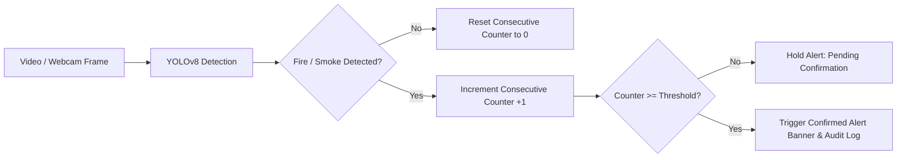

# AI-Based Real-Time Fire and Smoke Detection Using Computer Vision

A complete, production-ready, beginner-friendly computer vision project built with **Python**, **Ultralytics YOLOv8**, **OpenCV**, and **Streamlit**.

The system provides real-time detection of fire and smoke from static images, recorded video files, and live webcam feeds, equipped with **temporal consecutive-frame confirmation** to eliminate transient false alarms.

---

## 🌟 Key Features

1. **📷 Image Fire & Smoke Detection**:
   - Upload any image (`.jpg`, `.jpeg`, `.png`, `.webp`) or select from built-in sample benchmarks.
   - Side-by-side original vs. annotated view with high-contrast bounding boxes, class labels, and confidence percentages.
   - Granular bounding box telemetry coordinates and inference latency metrics.

2. **🎥 Frame-by-Frame Video Detection**:
   - Upload video files (`.mp4`, `.avi`, `.mov`, `.mkv`) or run the included sample video.
   - Real-time visual progress preview with adjustable frame stride for high-speed inference.
   - Download the annotated video with bounding boxes and labels rendered.

3. **📹 Real-Time Live Webcam Detection**:
   - Live continuous stream with interactive **Start** and **Stop** controls.
   - Hardware-accelerated DirectShow capture on Windows for instantaneous startup.
   - Includes **Browser Snapshot Mode** (`st.camera_input`) as a reliable fallback for headless/remote environments.
   - Live FPS and inference latency telemetry readout.

4. **🛡️ Consecutive-Frame Confirmation (False-Alarm Mitigation)**:
   - Prevents false alarms caused by sunlight reflections, yellow/orange jackets, vehicle headlights, or steam.
   - Configurable confirmation threshold ($K$ consecutive frames) and cooldown periods.

5. **🚨 Visual Emergency Alerts**:
   - High-visibility pulsing red alert banner for confirmed **FIRE**.
   - Amber alert banner for confirmed **SMOKE**.
   - Combined multi-hazard alert banner when both hazards are detected simultaneously.

6. **📊 Audit Trail & CSV Export**:
   - Timestamped log of all confirmed alert incidents with peak confidence scores.
   - One-click export to CSV for safety audit reporting.

---

## 🗂️ Project Structure

```text
fire-smoke-detection/
├── app.py                  # Streamlit dashboard & UI application
├── detector.py             # Ultralytics YOLO inference wrapper & OpenCV annotator
├── alert_manager.py        # Temporal confirmation state machine & incident logger
├── test_system.py          # Automated test suite (unit & integration tests)
├── requirements.txt        # Python dependency manifest
├── README.md               # Documentation & setup guide
├── models/                 # Model weights directory
│   └── fire_smoke_yolov8n.pt  # Fine-tuned YOLOv8 fire & smoke weights (~6.2 MB)
└── samples/                # Sample media assets for immediate 1-click testing
    ├── sample_fire_1.jpg
    ├── sample_smoke_1.jpg
    ├── sample_fire_smoke.jpg
    ├── dfire_examples.png
    └── sample_fire_video.mp4
```

---

## 📦 Model Information & Class Verification

This project uses an Ultralytics YOLOv8 Nano model fine-tuned on the **D-Fire** dataset (`rabahdev/fire-smoke-yolov8n`):

- **Model Architecture:** YOLOv8n (Nano)
- **Supported Classes:**
  - `0`: **smoke**
  - `1`: **fire**
- **Model Size:** ~6.2 MB (fast on CPU, ultra-fast on GPU)
- **Automatic Class Validation:** `detector.py` automatically checks the model's class dictionary upon loading. If an unrelated model is supplied (e.g. standard COCO model detecting cars and persons), it raises an `IncompatibleModelError` to prevent incorrect alerts.

### Using Custom Trained Weights
If you have trained your own YOLO model for fire and smoke:
1. Place your `.pt` file inside the `models/` directory (e.g. `models/my_custom_model.pt`).
2. In the Streamlit sidebar, enter your model path in the **Model Weights Path** input field.
3. Click **🔄 Reload Model**.

---

## 🚀 Getting Started

### 1. Prerequisites
- Python 3.10, 3.11, 3.12, 3.13, or 3.14.
- Windows 10/11, macOS, or Linux.

### 2. Installation
Open PowerShell or your command terminal in the project directory:

```bash
# Optional: Create and activate a virtual environment
python -m venv venv
.\venv\Scripts\activate      # On Windows
# source venv/bin/activate   # On Linux/macOS

# Install dependencies
pip install -r requirements.txt
```

### 3. Run Automated Tests
Verify your environment and model loading before launching:

```bash
python test_system.py
```

Expected output:
```text
Ran 7 tests in 4.5s
OK
```

### 4. Launch the Dashboard
Run the Streamlit application:

```bash
streamlit run app.py
```

The application will automatically launch in your default web browser at `http://localhost:8501`.

---

## 🛠️ How Consecutive-Frame Confirmation Works

In real-world computer vision, visual noise (such as sudden glare, cigarette smoke, or brightly colored clothing) can trigger momentary single-frame false positives.



- When fire is detected in a frame, `fire_consecutive` increments.
- If the hazard is detected for $K$ consecutive frames (e.g. 3 frames), the alert status transitions to **CONFIRMED ACTIVE**.
- If a frame does not detect fire, the counter immediately resets to 0.
- This simple yet effective temporal smoothing algorithm dramatically improves real-world reliability.

---

## 🔧 Windows & Webcam Troubleshooting

1. **DirectShow Optimization:**
   On Windows, webcam initialization using standard Media Foundation (MSMF) can sometimes exhibit a 5–10 second delay. This project automatically utilizes the DirectShow backend (`cv2.CAP_DSHOW`) on Windows to ensure instant camera startup.

2. **Webcam Permissions:**
   Ensure webcam access is enabled under **Windows Settings > Privacy & Security > Camera > Let desktop apps access your camera**.

3. **Camera Already in Use:**
   If the webcam fails to open, verify that other applications (such as Microsoft Teams, Zoom, or Skype) are not actively utilizing the camera device.

4. **Remote or Headless Deployments:**
   If running over SSH, WSL, or in a cloud instance without direct USB camera passthrough, navigate to the **Live Webcam** tab and select **Browser Snapshot Mode**. This utilizes your local web browser's camera API to capture frames.

---

## 📄 License
This project is open-source and intended for educational and safety monitoring purposes.
